# Planetary Analog Finder: Nasıl Çalışır?

Bu belge yazılımı baştan sona anlatır: hangi veriyi ne için kullandığımızı, hangi hesapları yaptığımızı, kodun nasıl düzenlendiğini ve uygulamanın nasıl kullanılacağını. Kurulum komutları ve ilk bilimsel sonuçlar [README](../README.md) dosyasındadır.

## İçindekiler

1. [Ne yapıyoruz?](#1-ne-yapıyoruz)
2. [Genel akış](#2-genel-akış)
3. [Veri kaynakları ve görevleri](#3-veri-kaynakları-ve-görevleri)
4. [Bir pencerenin işlenmesi](#4-bir-pencerenin-işlenmesi)
5. [Dünya kataloğu](#5-dünya-kataloğu)
6. [Benzerlik ve sıralama](#6-benzerlik-ve-sıralama)
7. [Yüzey ve güvenilirlik katmanları](#7-yüzey-ve-güvenilirlik-katmanları)
8. [Uygulamayı kullanma](#8-uygulamayı-kullanma)
9. [Notebook, komut satırı ve Python](#9-notebook-komut-satırı-ve-python)
10. [Kod yapısı](#10-kod-yapısı)
11. [Geliştirme](#11-geliştirme)
12. [Sınırlamalar](#12-sınırlamalar)
13. [Yol haritası](#13-yol-haritası)
14. [Terimler](#14-terimler)

## 1. Ne yapıyoruz?

Mars veya Ay üzerinde seçilen 60 km × 60 km'lik bir bölgeye **arazi biçimi bakımından** en çok benzeyen Dünya bölgelerini buluyoruz. Her eşleşme için neden seçildiğini, hangi veriye dayandığını ve sonucun ne kadar sağlam olduğunu da gösteriyoruz.

Temel fikir şu: iki uydu görüntüsünün birbirine benzemesi, iki yüzeyin bilimsel olarak benzer olduğu anlamına gelmez. Güneş açısı, renk, çözünürlük ve atmosfer görüntüyü değiştirir. Bu yüzden görüntüleri değil, yükseklik modellerinden (DEM) metre cinsinden hesaplanan ve fiziksel anlamı olan biçim ölçülerini karşılaştırıyoruz: eğim, engebelilik, rölyef ve havza biçimi gibi.

<picture>
  <source media="(prefers-color-scheme: dark)" srcset="img/jezero-salda-dark.png">
  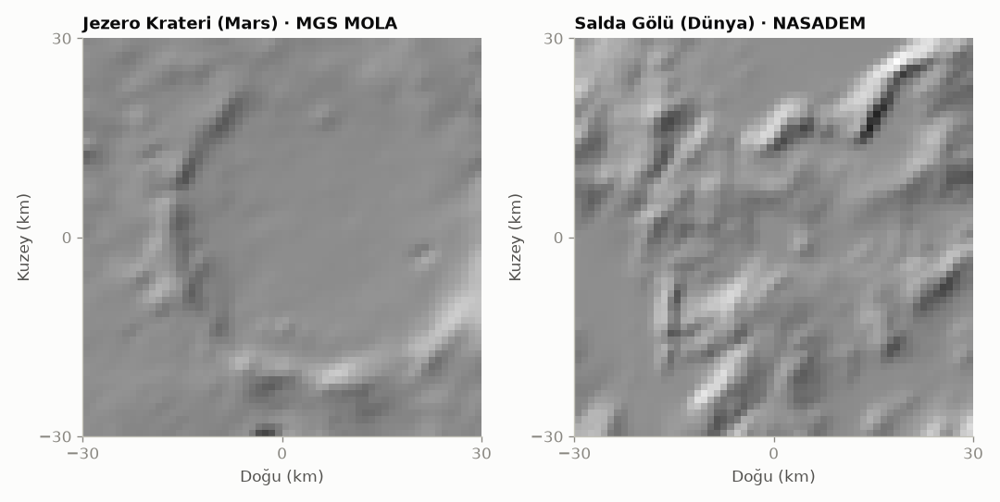
</picture>

*Şekil 1. Projenin çıkış noktası olan iki bölge, 60 km × 60 km ve aynı 1 km destekle. Jezero, Perseverance'ın indiği 45 km'lik krater. Salda Gölü karbonat mineralleri nedeniyle Jezero'nun bilinen analoğu, ama biçimleri farklı. Sistemin Salda için verdiği sonuç da bu: Salda, Dünya pencerelerinin yalnızca %9,8'inden daha yakın.*

Her adımda üç kural geçerlidir:

- **Mutlak yükseklik ve koordinat gövdeler arasında karşılaştırılmaz.** Mars'ın sıfır yüksekliği ile Dünya'nın deniz seviyesi aynı şey değildir.
- **Her veri önce aynı fiziksel çözünürlüğe getirilir.** 30 m'lik bir Dünya DEM'i ile 463 m'lik bir Mars DEM'i doğrudan karşılaştırılamaz.
- **Her sonuç kaynağı, sürümü ve belirsizliğiyle birlikte verilir.**

## 2. Genel akış

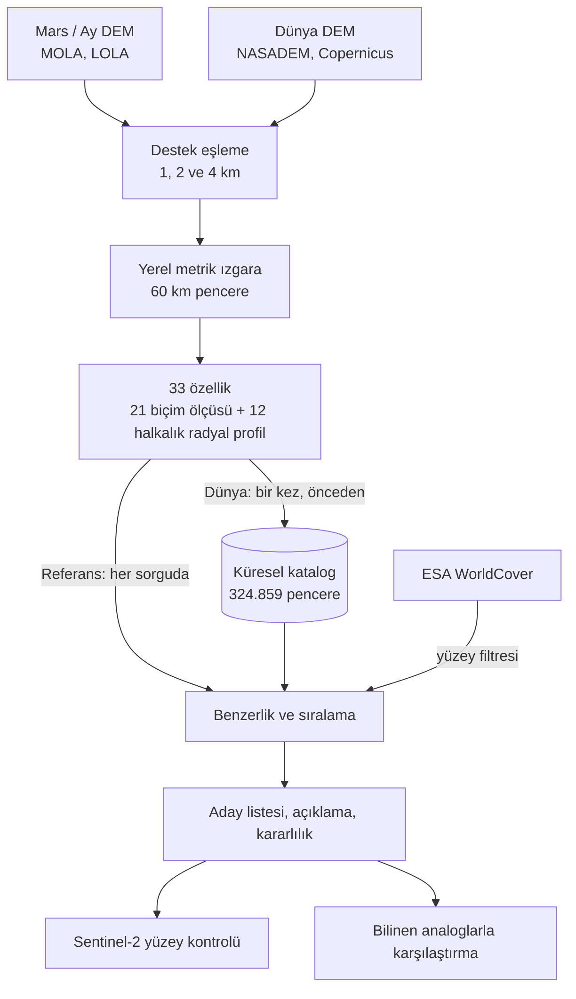

İş iki aşamada yapılır:

- **Önceden (çevrimdışı):** Dünya'nın karasal yüzeyi 60 km'lik pencerelere bölünür. Her pencerenin özellikleri bir kez hesaplanıp bir katalog dosyasına yazılır (`scripts/build_catalog.py`).
- **Sorguda (çevrimiçi):** Kullanıcı bir Mars veya Ay bölgesi seçtiğinde yalnızca o pencerenin DEM'i okunur ve özellikleri hesaplanır. Ardından katalogdaki bütün pencerelerle bellekte karşılaştırılır. Bu birkaç saniye sürer.

Belgenin geri kalanında her adımı aynı örnekle izliyoruz: **Jezero Krateri (18,38°K, 77,58°D) için Dünya'da analog aramak.**

## 3. Veri kaynakları ve görevleri

| Veri | Ne için kullanıyoruz | Kod | Erişim |
|---|---|---|---|
| MGS MOLA MEGDR 128 ppd (yaklaşık 463 m) | Mars referans penceresinin yüksekliği | `bodies.py`, `dem.py` | USGS global mozaik |
| MOLA MEGDR ölçüm sayısı (counts) | Mars penceresinde gerçek lazer ölçümü olan hücrelerin payı; iz deseni deneyi | `mola_support.py` | NASA PDS Geosciences |
| LRO LOLA LDEM 256 ppd (yaklaşık 118 m) | Ay referans penceresinin yüksekliği | `bodies.py`, `dem.py` | USGS global mozaik |
| NASADEM HGT v001, 1 yay saniyesi | Dünya yüksekliği, 56°G ile 60°K arası | `dem.py` | Microsoft Planetary Computer |
| Copernicus DEM GLO-90 | Dünya yüksekliği, 60°K üstü ve 56°G altı | `dem.py` | AWS Open Data |
| ESA WorldCover 2021 v200, 10 m | Dünya pencerelerinin arazi örtüsü payları; bitki örtüsü, tarım, su ve yerleşimin elenmesi | `landcover.py` | AWS Open Data |
| Sentinel-2 L2A | Seçilen adayın yüzeyine bakmak ve basit spektral göstergeler | `surface.py` | Earth Search STAC ve AWS |
| NASA Solar System Treks katmanları | Mars ve Ay haritasında geniş görünüm (yalnızca görsel) | `app/` | trek.nasa.gov |
| OpenStreetMap, Esri World Imagery | Dünya haritasında adayların konumu (yalnızca görsel) | `app/` | Folium karo katmanları |

Bu kaynakların hiçbiri hesap gerektirmez. Dosyalar Cloud Optimized GeoTIFF biçimindedir ve HTTP aralık istekleriyle okunur, yani yalnızca istenen bölgenin baytları indirilir. İndirilen her şey `data/cache/` altında saklanır. Bu klasör git'e girmez; küresel katalog için yaklaşık 1,1 GB tutar ve istenildiğinde silinebilir. Konumu `ANALOG_CACHE` ortam değişkeniyle değiştirilebilir.

Yükseklik verilerinin Mars ve Ay tarafı NASA görevlerinden gelir. Dünya tarafının büyük kısmı ise Avrupa'nın Copernicus programına aittir (Copernicus DEM, WorldCover, Sentinel-2).

## 4. Bir pencerenin işlenmesi

Aşağıdaki adımlar Mars, Ay ve Dünya pencereleri için birebir aynıdır. Kodun büyük kısmı `terrain.py` dosyasındadır.

### 4.1 DEM okuma (`dem.py`)

- **Mars ve Ay:** Global mozaikten pencerenin merkezinden her yöne 46,5 km'lik alan okunur. Bu, 60 km'lik pencereyi, filtrelerin kenar payını ve radyal profilin merkez aramasını kapsar. LOLA'nın ölçek çarpanı (0,5 m/DN) uygulanır. 80°'den yüksek enlemlerde kutup ürünü gerektiği için okuma reddedilir. ±180° boylam çizgisini kesen pencereler de henüz desteklenmez.
- **Dünya:** Veri 1° × 1°'lik karolar hâlinde okunur: 56°G ile 60°K arasında NASADEM, diğer enlemlerde Copernicus DEM. Her karo 15 yay saniyesine (ekvatorda yaklaşık 463 m, MOLA ızgarasına yakın) ortalama alınarak indirgenir ve tam metre olarak önbelleğe yazılır. Sunucuda bulunmayan bir karo (HTTP 404) açık deniz sayılır. Başka hatalar, örneğin hız sınırlaması, hata olarak bildirilir. Böylece geçici bir ağ sorunu karayı sessizce denize çevirmez.

### 4.2 Destek eşleme

Eğim, üzerinde ölçüldüğü mesafeye bağlıdır. 30 m'lik piksellerden ölçülen eğim, 463 m'lik piksellerden ölçülenden çok daha yüksek çıkar. Notebook'taki örnekte Salda'nın ortalama eğimi Jezero'nunkinin ham piksellerde 3,3 katı, aynı 1 km destekte ise 1,7 katıdır.

Bu yüzden her DEM, analiz ölçeğine (s = 1, 2 veya 4 km) bir Gauss filtresiyle yumuşatılır:

- Hedef yumuşatma genişliği σ = 0,5 × s.
- d genişliğindeki bir kaynak pikselin zaten d²/12 varyansı vardır. Bu yüzden yalnızca kalan kısım uygulanır: σ_uygulanan = √((0,5 s)² − d²/12). Böylece 30 m ve 463 m kaynaklar aynı toplam desteğe ulaşır.
- Filtre boş hücreleri yok sayar. Verinin yarıdan azını gören hücreler boş bırakılır.
- Ölçek, kaynak pikselin en az 1,9 katı olmalıdır; değilse hesap reddedilir. MOLA için en küçük ölçek yaklaşık 880 m olduğundan 1 km uygundur.

**Örnek (1 km ölçek):** Hedef σ = 0,5 × 1.000 m = 500 m.

| Kaynak | Piksel (d) | Pikselin taşıdığı varyans d²/12 | Uygulanan σ |
|---|---|---|---|
| MOLA (Jezero) | 463 m | 17.871 m² | √(500² − 17.871) ≈ 482 m |
| NASADEM 1″ (Salda) | 30 m | 75 m² | √(500² − 75) ≈ 500 m |

MOLA'nın pikseli zaten kaba olduğu için ona daha az yumuşatma uygulanır, 30 m'lik veriye ise neredeyse tam 500 m uygulanır. Sonuçta ikisi aynı noktaya gelir.

<picture>
  <source media="(prefers-color-scheme: dark)" srcset="img/destek-esleme-dark.png">
  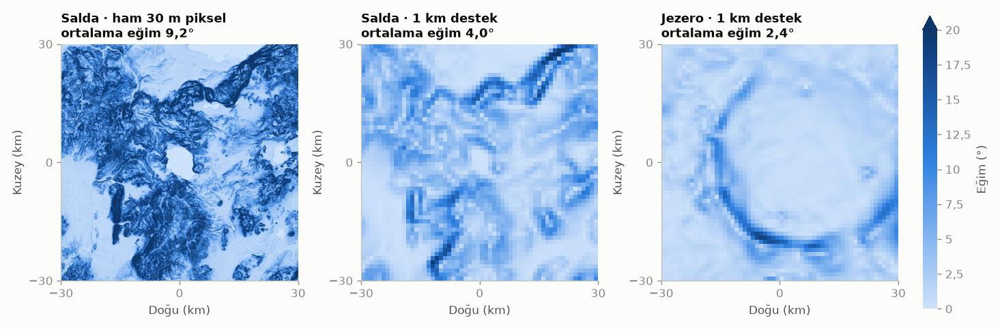
</picture>

*Şekil 2. Aynı Salda arazisi ham 30 m piksellerde ortalama 9,2° eğim gösteriyor, 1 km destekte 4,0°. Jezero 1 km destekte 2,4°. Ham piksellerle karşılaştırılsaydı Salda 3,3 kat daha dik görünürdü; doğru karşılaştırmada fark 1,7 kat.*

### 4.3 Yerel metrik ızgara

Yumuşatılmış DEM, pencere merkezli ve kuzeyi yukarıda olan bir metre ızgarasına örneklenir. Bunun için gövdenin kendi yarıçapıyla azimutal eşit uzaklık izdüşümü kullanılır: Mars 3.396,19 km, Ay 1.737,4 km, Dünya 6.371,007 km. Dünya küre kabul edilir; 60 km içinde bunun hatası %0,4'ün altındadır ve DEM hatasından çok küçüktür.

Hücre aralığı ölçeğe eşittir: 1 km'de 60 × 60, 2 km'de 30 × 30, 4 km'de 15 × 15 hücre. 1 km ızgaranın en az %95'i veriyle dolu değilse pencere geçersiz sayılır. Kalan küçük boşluklar en yakın değerle doldurulur.

<picture>
  <source media="(prefers-color-scheme: dark)" srcset="img/olcekler-dark.png">
  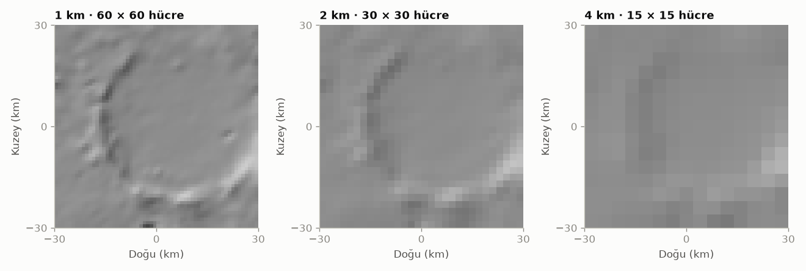
</picture>

*Şekil 3. Jezero penceresi üç analiz ölçeğinde. 1 km'de krater kenarı belirgin, 4 km'de yalnızca büyük biçim kalıyor. Her ölçeğin özellikleri ayrı hesaplanır, böylece hem ayrıntı hem genel biçim karşılaştırmaya girer.*

### 4.4 Özellikler

Her pencere 33 sayıyla özetlenir. Her ölçekte 5 özellik hesaplanır (3 ölçekte toplam 15). Buna pencerenin bütününü 1 km ızgarada anlatan 6 özellik ve 12 halkalık radyal profil ([4.5](#45-radyal-profil)) eklenir.

| Özellik | Nasıl hesaplanır | Ne anlatır | Aile |
|---|---|---|---|
| `slope_mean`, `slope_std`, `slope_p95` | Eğim = arctan(\|∇z\|), merkezi farklarla; ortalama, standart sapma ve 95. yüzdelik | Yüzey ne kadar dik, diklik ne kadar değişken | Eğim |
| `tri` | Her hücrenin 8 komşusuna ortalama mutlak yükseklik farkı (m) | Kısa mesafede engebe | Engebelilik |
| `rough` | Yüksekliğin 3 × 3 ortalamasından sapmalarının standart sapması (m) | Yerel pürüzlülük | Engebelilik |
| `relief` | Yüksekliğin 99. ve 1. yüzdelikleri arasındaki fark (m) | Pencerenin toplam yükselti aralığı | Rölyef |
| `elev_std` | En uygun düzlem çıkarıldıktan sonra yüksekliğin standart sapması (m) | Bölgesel eğimden arındırılmış oynaklık | Rölyef |
| `hypso` | Hipsometrik integral: (ortalama − P1) / (P99 − P1), 0 ile 1 arası | Alanın çoğu alçakta mı yüksekte mi | Biçim |
| `skew` | Düzlemden arındırılmış yüksekliğin çarpıklığı | Negatif: dar ve derin çukurlar; pozitif: tepeler | Biçim |
| `radial_r2` | Pencere merkezi etrafındaki 12 halkanın ortalama profilinin açıkladığı varyans payı | Dairesel simetri; krater, havza ve kubbede yüksek | Biçim |
| `basin_depth` | Dış halkaların (r ≥ 0,75 R) ortalaması eksi merkezin (r ≤ 0,4 R) ortalaması (m) | Pozitifse merkez kenarlardan alçak | Biçim |

Pencereye dik bir düzlem uydurulup çıkarılır, çünkü bölgesel eğim biçim gibi görünmemelidir. Testler, eğimli bir düzlem eklemenin ve yüksekliği topluca kaydırmanın biçim özelliklerini değiştirmediğini doğrular.

**Örnek: Jezero ve Salda'nın pencere özellikleri**

| Özellik | Jezero | Salda | Okuma |
|---|---|---|---|
| Ortalama eğim @ 1 km | 2,4° | 4,0° | Salda daha engebeli |
| Yükselti farkı (P1–P99) | 957 m | 1.120 m | Toplam rölyef yakın |
| Hipsometrik integral | 0,43 | 0,44 | Yükseklik dağılımı benzer |
| Çarpıklık | 0,30 | 0,55 | |
| Dairesel simetri R² | 0,58 | 0,16 | Jezero dairesel, Salda değil |
| Havza derinliği | +429 m | −150 m | Jezero'da merkez kenardan alçak, Salda'da yüksek |

Bu tablo, eğim ve rölyef yakın olsa bile son iki biçim özelliğinin iki bölgeyi neden ayırdığını gösterir.

<picture>
  <source media="(prefers-color-scheme: dark)" srcset="img/ozellikler-dark.png">
  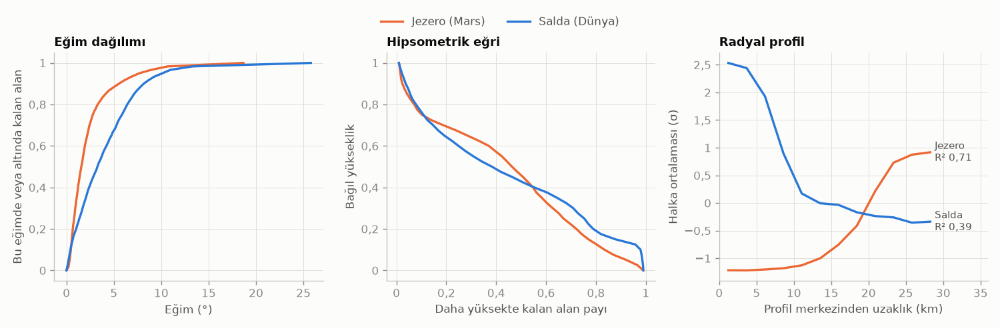
</picture>

*Şekil 4. Özelliklerin dayandığı üç eğri. Eğim dağılımı: Jezero'da alanın %80'i 3°'nin altında. Hipsometrik eğri: ikisi neredeyse aynı. Radyal profil: Jezero'da düz bir tabandan sonra 17–25 km arasında dik bir duvar yükseliyor. Salda'nın en simetrik merkezi pencere merkezinden 14 km ötedeki bir tepe; profili merkezde yüksek ve dışarı doğru alçalıyor, yani Jezero'nunkinin tersi.*

### 4.5 Radyal profil

Biçim ailesindeki `radial_r2` ve `basin_depth`, profili pencere merkezinin etrafında ölçer. Pencereler 20 km arayla dizildiği için Dünya'daki bir yapının merkezi en yakın pencere merkezinden 14,1 km'ye kadar uzakta olabilir. Bu durumda sabit merkezli bir profil yapıyı göremez. Radyal profil bu sorunu iki adımda çözer:

1. **Merkezi arar.** Pencere merkezinin 15 km çevresindeki her nokta aday merkezdir. Önce 3 km aralıklı noktalar, sonra en iyisinin çevresi 1 km adımla denenir. Her aday merkez etrafında 29,5 km yarıçaplı bir disk alınır, düzlem çıkarılır ve 12 halkanın ortalama profilinin açıkladığı varyans payı (R²) hesaplanır. En yüksek R²'yi veren merkez seçilir. Disk verinin dışına taşıyorsa o merkez kullanılmaz.
2. **Profili birimsiz yazar.** Her halkanın ortalaması, diskteki yükseklik oynaklığına (standart sapma, σ) bölünür. Böylece profil kraterin derinliğini değil biçimini taşır. Bu önemlidir, çünkü krater derinliği yerçekimiyle değişir. Profilin büyüklüğü simetriyle birlikte artar: halkaların alanla ağırlıklı kare ortalaması R²'ye eşittir.

Yükseklik oynaklığı 1 m'nin altındaki pencereler (göl yüzeyleri gibi) DEM'in hassasiyetinde düz sayılır ve profilleri sıfır olur. Bu 12 halka ayrı bir aile oluşturur. Karşılaştırmada halkalar ortak bir ölçekle bölünür, yani profil halka halka değil tek bir eğri olarak karşılaştırılır.

<picture>
  <source media="(prefers-color-scheme: dark)" srcset="img/radyal-profil-dark.png">
  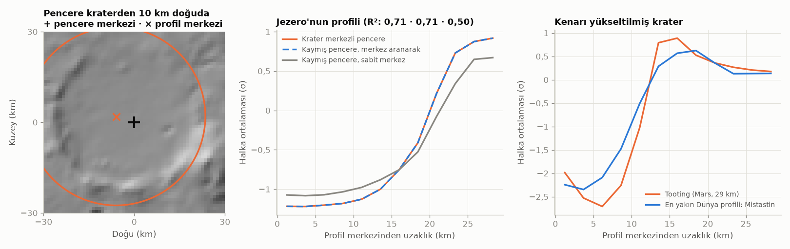
</picture>

*Şekil 5. Solda: pencere Jezero'nun 10 km doğusuna kaydırıldığında arama krateri yeniden buluyor (×). Ortada: kaymış pencerenin aranarak bulunan profili (kesikli) krater merkezli pencereninkiyle üst üste biniyor; R² ikisinde de 0,71. Sabit merkezle profil yayvanlaşıyor ve R² 0,50'ye düşüyor. Sağda: Mars'taki genç Tooting kraterinin (29 km) profili ve Dünya kataloğunda ona yalnızca profile bakarak en yakın çıkan pencere: Kanada'daki Mistastin çarpma krateri. İkisinde de kenar yükselip dışarıda yeniden alçalıyor.*

Jezero'nun profilinde bu dış alçalma yok: kenarı aşınmış ve 60 km'lik pencerede dışarı doğru düzleşiyor. Bu yüzden Jezero'nun profili kapalı bir havzanınkine benziyor ve en yakın adayları profil eklendikten sonra da aynı kalıyor ([6](#6-benzerlik-ve-sıralama)).

## 5. Dünya kataloğu

`scripts/build_catalog.py`, `catalog.py` modülünü çalıştırır:

1. **Pencere merkezleri:** 56°G ile 83°K arası, −179° ile 179° boylamları ve ayrıca McMurdo Kuru Vadileri (Antarktika) taranır. Merkezler yerde 20 km arayla dizilir; boylam adımı enleme göre genişler. Toplam 1.155.795 merkez çıkar.
2. **İndirme:** Gereken 50.801 DEM karosu ve WorldCover karoları 12 paralel bağlantıyla indirilir.
3. **Eleme:** Yüzde 30'dan fazlası deniz olan (yükseklik 0 veya veri yok) ya da %95'ten azı geçerli olan pencereler atılır. Geriye 324.859 pencere kalır.
4. **Özellikler:** Her pencerenin 33 özelliği 8 paralel süreçte hesaplanır. Profilin uygunluğunu göstermek için bulunan merkezin kayması (`prof_dx_km`, `prof_dy_km`) ve simetrisi (`prof_r2`) de saklanır. Pencerenin WorldCover sınıf payları da eklenir: ağaç, çalı, çayır, tarım, yerleşim, çıplak zemin, kar, su, sulak alan, mangrov ve yosun. Bu paylar WorldCover'ın 1/64'lük önizlemesinden (yaklaşık 640 m örnekler, pencere başına yaklaşık 10.000 örnek) okunur.
5. **Çıktı:** `data/catalog/earth_global.parquet` dosyasında (yaklaşık 52 MB, zstd sıkıştırmalı) her satır bir penceredir. Yanındaki `.json` dosyası üretim zamanını, bölgeleri, pencere ve adım boyunu, ölçekleri, özellik listesini, yöntemi, veri kaynaklarını, yazılım sürümlerini, başarısız karoları ve süreleri kaydeder.

<picture>
  <source media="(prefers-color-scheme: dark)" srcset="img/katalog-dark.png">
  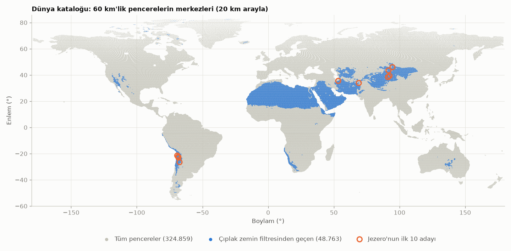
</picture>

*Şekil 6. Katalogdaki 324.859 pencerenin merkezleri. Mavi olanlar çıplak zemin filtresinden geçen 48.763 pencere: Sahra, Arabistan, İran, Orta Asya, Atacama, Namibya, ABD'nin güneybatısı ve Avustralya'nın kurak bölgeleri. Turuncu halkalar Jezero için bulunan ilk 10 aday.*

Sıfırdan üretim yaklaşık bir saat sürer. Önbellek doluysa 15 dakika kadar yeter. Uygulama özellik listesini kataloğun `.json` dosyasından okur, bu yüzden yeni özellikler eklenmiş bir katalog uygulamada kod değişikliği gerektirmeden çalışır.

15 yay saniyelik ızgaranın etkisi notebook'ta ölçülmüştür: 30 m kaynağa göre fark 1 km ölçekte en çok %4,6, 2–4 km ölçekte çoğunlukla %1,5'in altındadır.

## 6. Benzerlik ve sıralama

Kod `similarity.py` dosyasındadır.

1. **Dönüşüm.** Farkların karşılaştırılabilir anlamlar taşıması için özellikler dönüştürülür. Eğim, TRI, pürüzlülük, rölyef ve `elev_std` için log(1 + x) alınır, çünkü bu büyüklükler çarpımsal yayılır. Havza derinliği için arcsinh(derinlik / 100 m) kullanılır; bu dönüşüm işareti korur, sıfır çevresinde doğrusal, uçlarda logaritmiktir. `hypso`, `skew`, `radial_r2` ve profil halkaları olduğu gibi kalır.
2. **Ölçekleme.** Her özellik, bütün Dünya pencerelerinin medyanına göre ortalanır ve çeyrekler arası aralığına (IQR) bölünür. Böylece birim "Dünya'daki tipik yayılım" olur ve aykırı değerler sonucu ele geçiremez. Profil halkalarının hepsi aynı ölçeğe, halkaların IQR'lerinin medyanına bölünür. Referansın bir özelliği bu birimde 3'ten büyük çıkarsa uygulama "Dünya'da nadir" uyarısı gösterir.
3. **Ağırlıklar.** Varsayılan aile ağırlıkları şöyledir: eğim 0,25, engebelilik 0,20, rölyef 0,15, biçim 0,20, radyal profil 0,20. Profil ağırlığı kör arama deneyleriyle seçildi ([7.3](#73-güvenilirlik-deneyleri-validationpy-notebook)). Biçim ailesi daha çok azaltıldı, çünkü iki üyesi profille aynı bilgiyi kısmen taşıyor. Her ailenin ağırlığı üyelerine bölünür, bu yüzden çok üyeli bir aile tek başına baskın olamaz. Bir aile içinde 1 km özellikleri yarım ağırlık alır. Bunun nedeni MOLA iz deseni deneyidir: 1 km özellikleri %8–17, 2–4 km özellikleri %1–8 değişiyor. Toplam ağırlık 1'dir. Kullanıcı kaydırıcılarla aile ağırlıklarını değiştirebilir.
4. **Mesafe.** d = √(Σ wᵢ (z_aday,ᵢ − z_referans,ᵢ)²). Bu, Dünya yayılımı biriminde ağırlıklı ortalama karesel farktır. 0 birebir aynı demektir.
5. **Yüzey filtresi.** Mars'ta ve Ay'da bitki örtüsü ve açık su olmadığı için varsayılan olarak çıplak Dünya yüzeyi aranır: çıplak zemin en az %50; ağaç en çok %10, tarım %15, yerleşim %3, su %15, kar %20.
6. **Seçim.** Komşu pencereler birbiriyle örtüştüğü için aynı yer listeyi doldurabilir. Bunu önlemek için en yakından başlanarak seçilmiş bir adaya 60 km'den yakın olan pencereler atlanır.
7. **Her adayın göstergeleri:**
   - **Benzerlik (0–100)** = 100 × e^(−d). Yalnızca okumayı kolaylaştırır, olasılık değildir.
   - **Yüzdelik:** Taranan bütün pencerelerin (filtreden önce) kaçının referansa bu adaydan daha uzak olduğu.
   - **Kararlılık:** Ağırlıklar seçilen değerlerin çevresinde 300 kez rastgele değiştirilir (Dirichlet dağılımı). Adayın bu denemelerin kaçında uygun pencerelerin en yakın %0,1'i içinde kaldığı ölçülür; bu dilim en az 20 penceredir. Hız için en çok 20.000 pencerelik rastgele bir örnek kullanılır. Yüksek kararlılık, sonucun ağırlık seçimine bağlı olmadığını gösterir.
   - **Aile uyumu:** Her ailenin kendi fark değeri d_f, 100 × e^(−d_f) olarak gösterilir.
   - **Özellik katkısı:** wᵢ Δzᵢ² / Σ. Farkın en çok hangi özellikten geldiğini söyler.

### Örnek: Jezero için arama

324.859 pencerenin 48.763'ü çıplak zemin filtresinden geçer. Hepsinin Jezero'ya mesafesi hesaplanır:

<picture>
  <source media="(prefers-color-scheme: dark)" srcset="img/mesafe-dagilimi-dark.png">
  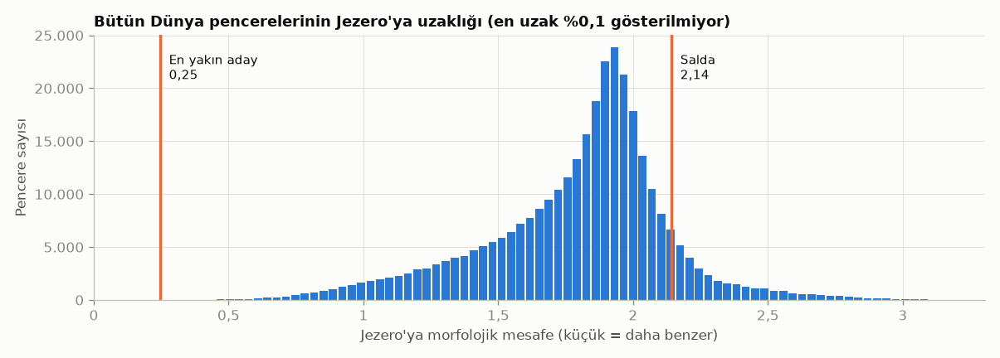
</picture>

*Şekil 7. Pencerelerin çoğu Jezero'dan 2 birim kadar uzakta. En yakın aday 0,25'te, dağılımın en ucunda duruyor. Salda 2,14 ile pencerelerin %90'ından daha uzak.*

En yakın aday Çin'in Sincan bölgesindeki bir kapalı havza (43,47°K, 91,62°D). Göstergeleri şöyle:

- Mesafe d = 0,246, yani benzerlik = 100 × e^(−0,246) ≈ **78**.
- Yüzdelik **%99,998**: Taranan pencerelerin neredeyse hepsinden daha yakın.
- Kararlılık **%100**: 300 rastgele ağırlık denemesinin hepsinde en yakın %0,1 içinde kaldı.
- Aile uyumu: eğim 82, engebelilik 93, rölyef 89, biçim 74, radyal profil 69.

<picture>
  <source media="(prefers-color-scheme: dark)" srcset="img/adaylar-dark.png">
  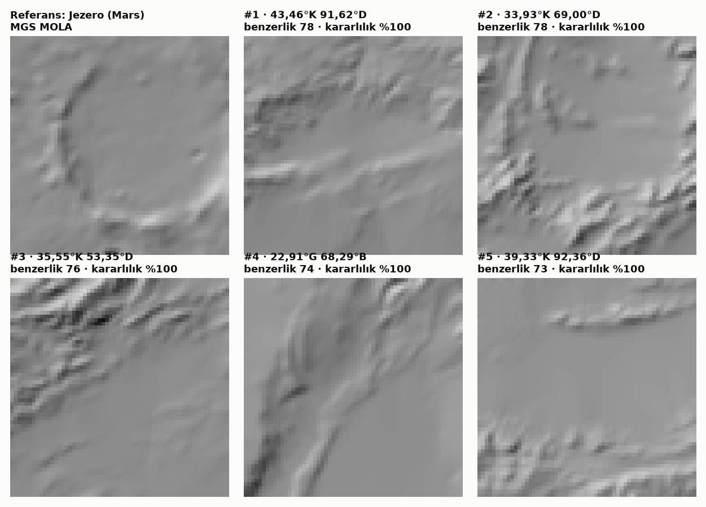
</picture>

*Şekil 8. Jezero ve en yakın beş Dünya penceresi, aynı ölçekte. Adayların hepsi kenarları yüksek, tabanı düz havzalar; dairesel krater değiller. Radyal profil eklenmeden önce de liste aynıydı: bu havzaların profili Jezero'nunkine zaten benziyor, çünkü Jezero'nun aşınmış kenarı da dışarı doğru alçalmıyor ([4.5](#45-radyal-profil)).*

Farkın kaynakları özellik katkısı tablosundan okunur. En büyük dört katkı:

| Özellik | Jezero | Aday | z farkı | Ağırlık | Katkı |
|---|---|---|---|---|---|
| Dairesel simetri R² | 0,585 | 0,536 | −0,43 | 0,050 | %15 |
| Radyal profil, 0–2,5 km halkası | −1,22σ | −1,83σ | −0,60 | 0,017 | %10 |
| Radyal profil, 2,5–4,9 km halkası | −1,22σ | −1,81σ | −0,57 | 0,017 | %9 |
| Radyal profil, 4,9–7,4 km halkası | −1,20σ | −1,72σ | −0,50 | 0,017 | %7 |

Biçim ailesinin 0,20'lik ağırlığı dört üyesine bölündüğü için her biri 0,05 alır. Profilin 0,20'si 12 halkaya bölünür, her halka yaklaşık 0,017 alır. Eğim ailesinin 0,25'i 9 üyeye bölünür ve 1 km üyeleri yarım sayılır, bu yüzden 2 km'deki bir eğim özelliği 0,033 alır. Katkı = ağırlık × (z farkı)², bütün özelliklerin toplamına bölünmüş hâli.

<picture>
  <source media="(prefers-color-scheme: dark)" srcset="img/katki-dark.png">
  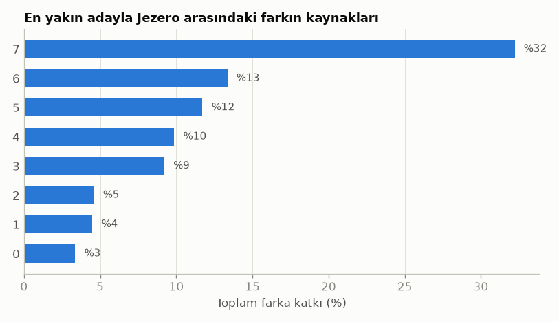
</picture>

*Şekil 9. Farkın en büyük kaynakları dairesel simetri ve profilin iç halkaları: aday Jezero kadar yuvarlak değil ve tabanı merkeze doğru daha çok çukurlaşıyor, Jezero'nun tabanı ise düz.*

## 7. Yüzey ve güvenilirlik katmanları

### 7.1 Sentinel-2 yüzey kontrolü (`surface.py`)

Yalnızca kullanıcı seçili aday için düğmeye bastığında çalışır.

- Earth Search STAC kataloğunda pencerenin merkezini içeren sahneler aranır. Koşullar: Haziran 2024 ile Eylül 2026 arası, bulut %15'ten az, eksik piksel %25'ten az. En az bulutlu 5 sahne denenir. Kullanılabilir alanı %85'i geçen ilk sahne alınır; hiçbiri geçmezse en iyisi kullanılır.
- Pencere için kırmızı, yakın kızılötesi (NIR), SWIR1 (B11), SWIR2 (B12), sahne sınıflandırması (SCL) ve gerçek renkli görüntü 512 × 512 olarak okunur. SCL ile veri yok, doygun, gölge, bulut ve sirrus pikselleri maskelenir.
- Göstergeler:
  - NDVI = (NIR − kırmızı) / (NIR + kırmızı), medyan ve 90. yüzdelik. Yeşil alan payı NDVI > 0,4 olan piksellerdir.
  - NDMI = (NIR − SWIR1) / (NIR + SWIR1). Nem göstergesidir.
  - SWIR B11/B12 oranı. Kil ve karbonat gibi bazı mineraller SWIR2'de soğurma yaptığı için bir ipucu verir, ama tek başına mineral tanımlamaz.
  - Kapsama: pencerenin kullanılabilir piksel payı.

<picture>
  <source media="(prefers-color-scheme: dark)" srcset="img/sentinel2-dark.png">
  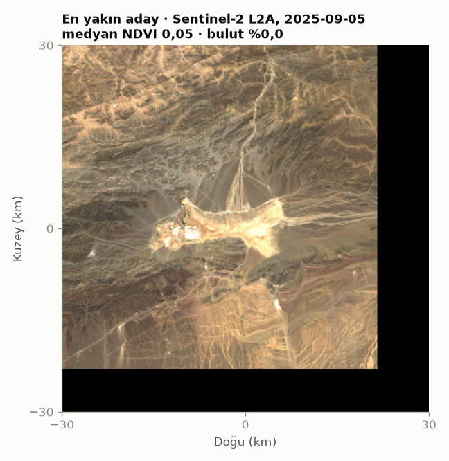
</picture>

*Şekil 10. Jezero'nun en yakın adayı Sentinel-2'de. Medyan NDVI 0,05, yani bitki örtüsü yok denecek kadar az. Açık renkli düz bir tabana inen yelpaze ve kanal izleri görülüyor; bu görsel bir yorumdur, saha verisiyle doğrulanmamıştır. Sağdaki ve alttaki siyah alan, sahnenin pencereyi kapsamadığı kısım: seçilen sahne bir MGRS karosunun kenarında kalıyor.*

### 7.2 MOLA veri desteği (`mola_support.py`)

MOLA'nın 463 m'lik hücrelerinin çoğu, yörünge izleri arasından enterpolasyonla doldurulmuştur. MEGDR "counts" ürünü her hücreye kaç lazer atımı düştüğünü söyler. Uygulama, seçilen Mars penceresinde gerçek ölçümü olan hücrelerin payını gösterir; Jezero'da bu oran %32,9'dur. 1 km özelliklerinin yarım ağırlık almasının nedeni budur.

<picture>
  <source media="(prefers-color-scheme: dark)" srcset="img/mola-izleri-dark.png">
  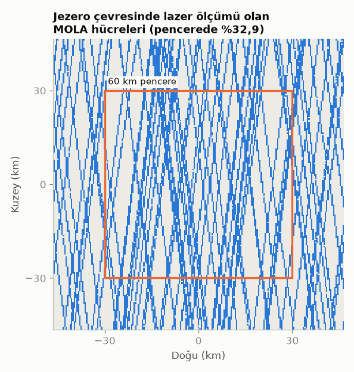
</picture>

*Şekil 11. Mavi hücrelerde en az bir lazer ölçümü var. Ölçümler kuzey–güney yönlü yörünge izleri boyunca diziliyor; aradaki boşluklar enterpolasyonla doldurulmuş. Kör arama deneyi bu deseni Dünya pencerelerine uygulayarak yöntemin bu eksikliğe ne kadar dayanıklı olduğunu ölçer.*

### 7.3 Güvenilirlik deneyleri (`validation.py`, notebook)

- **İz deseni deneyi:** Bir Dünya penceresi, gerçek MOLA izlerinin ölçeceği hücrelerden yeniden kurulur; boşluklar doğrusal enterpolasyonla doldurulur. Ardından her özelliğin ne kadar değiştiği ölçülür.
- **Kör arama:** Bu şekilde bozulmuş 396 rastgele Dünya penceresi katalogda aranır ve kendi yerinin kaçıncı sırada çıktığına bakılır.
- **Kaymış sorguyla kör arama:** Gerçek bir Mars bölgesi hiçbir Dünya pencere merkezine denk gelmez. Bu yüzden sorgu, rastgele bir pencereden en çok 10 km kaydırılmış bir noktadan alınır ve yine MOLA iz deseniyle bozulur. Sorgunun 15 km yakınındaki bir pencere üst sıralarda çıkarsa yer bulunmuş sayılır.

| Kör arama | İlk sırada | İlk 10'da | İlk 100'de | Medyan sıra |
|---|---|---|---|---|
| Pencere merkezinde, profilsiz | %84,8 | %95,7 | %98,5 | 1 |
| Pencere merkezinde, varsayılan | %88,6 | %91,4 | %92,9 | 1 |
| 10 km'ye kadar kaymış, profilsiz | %9,3 | %23,6 | %40,7 | 268 |
| 10 km'ye kadar kaymış, varsayılan | %20,1 | %33,9 | %50,8 | 97 |

İki şey okunur. Birincisi, pencere merkezindeki kör arama yöntemin gerçekçi başarısını olduğundan çok gösteriyor; sorgu 10 km kayınca isabet dörtte birin altına iniyor. İkincisi, radyal profil kaymış sorguda ilk sıra isabetini iki katına çıkarıyor, ama pencere merkezindeki sorguda ilk 10 ve ilk 100 oranlarını düşürüyor. Bunun nedeni, simetrisi zayıf pencerelerin bir kısmında MOLA boşluklarının profil merkezini başka bir yapıya sıçratması. Varsayılan ağırlık (0,20) bu iki etki arasında seçildi; 0,1 ile 0,4 arasındaki ağırlıklar benzer sonuç veriyor. Her durumda sorgu ve katalog aynı gezegenden geldiği için bunlar üst sınırdır, gezegenler arası geçerliliği kanıtlamaz.
- **Çözünürlük yanlılığı:** Salda için 30 m ve 15 yay saniyelik kaynaklardan hesaplanan özellikler karşılaştırılır.

### 7.4 Bilinen analoglar (`sites.py`)

Literatürde geçen 15 Dünya analogu, neyin analoğu oldukları notuyla birlikte listelenir: mineraloji, iklim, kimya, volkanizma veya morfoloji. Her biri kendi tam koordinatında aynı yöntemle ölçülür ve seçilen referansa göre mesafesi ve yüzdeliği gösterilir. Bu, morfolojileri nedeniyle seçilmiş analogların kimya veya iklim nedeniyle seçilenlerden daha yakın çıkıp çıkmadığını sınamayı sağlar.

## 8. Uygulamayı kullanma

Canlı sürüm Streamlit Community Cloud'da çalışır: https://mars-dunya-eslestirme.streamlit.app. `main` dalına yapılan her push birkaç dakika içinde oraya yansır. Yerelde `streamlit run app/streamlit_app.py` ile açılır (kurulum için README'ye bakın). Bir alan ilk kez seçildiğinde DEM okunurken bir dakikaya kadar beklemek gerekebilir; sonraki açılışlar önbellekten gelir.

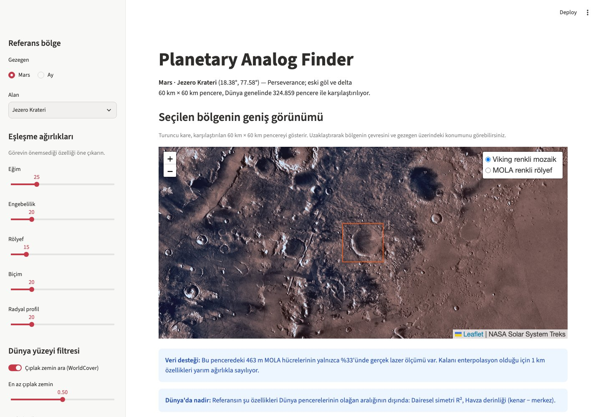

*Şekil 12. Uygulama Jezero seçiliyken. Solda ayarlar; sağda Jezero'nun Viking mozaiği üzerindeki penceresi (turuncu kare) ve iki uyarı: MOLA verisinin yalnızca %33'ü gerçek ölçüm, iki biçim özelliği de Dünya'da nadir.*

### Sol panel

1. **Gezegen:** Mars veya Ay.
2. **Alan:** Hazır alanlardan biri ya da "Özel koordinat". Mars için Jezero, Gale, Gusev, Meridiani Planum, Oxia Planum ve Holden; Ay için Apollo 11, 15 ve 17 bölgeleri, Copernicus ve Tycho var. Özel koordinatta enlem −80° ile 80°, boylam −180° ile 180° arasında olmalı; doğu pozitiftir.
3. **Eşleşme ağırlıkları:** Beş aile için 0–100 arası kaydırıcılar. Örneğin bir rover rotası için eğim ailesi, krater biçimi için radyal profil öne çıkarılabilir.
4. **Dünya yüzeyi filtresi:** Açılıp kapatılabilir; çıplak zemin, ağaç, tarım ve su eşikleri ayarlanabilir.
5. **Aday sayısı:** 3 ile 20 arası.

### Ana sayfa, yukarıdan aşağıya

1. **Geniş görünüm:** Seçilen bölgenin yakınlaştırılabilir haritası. Turuncu kare, karşılaştırılan 60 km'lik penceredir.
2. **Uyarılar:** Mars için gerçek lazer ölçümü payı; referansın Dünya'da nadir görülen özellikleri.
3. **En yakın adaylar:** Sıra, konum, benzerlik, yüzdelik, kararlılık ve çıplak zemin payı tablosu. Yanında Dünya haritası var; uydu görüntüsüne katman menüsünden geçilir.

   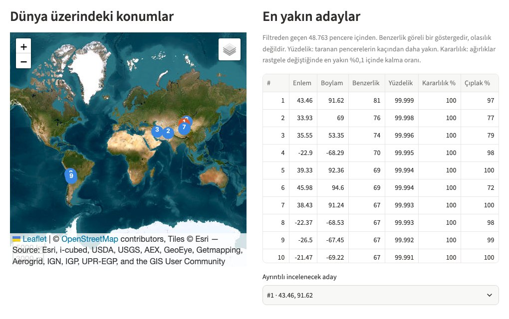

   *Şekil 13. Jezero için ilk 10 aday. Altındaki seçim kutusu, raporu hangi aday için göstereceğini belirler.*

4. **Karşılaştırma raporu:** Seçilen aday için şunları içerir:
   - özet cümle,
   - iki pencerenin aynı fiziksel ölçekte, kuzeyi yukarıda gölgelendirilmiş rölyefi,
   - aile uyumu çubukları,
   - üç grafik: 1 km'de eğim dağılımı, hipsometrik eğri, radyal profil (altında iki profilin merkez kayması ve simetrisi yazar),
   - her özelliğin farka katkısını gösteren tablo.

   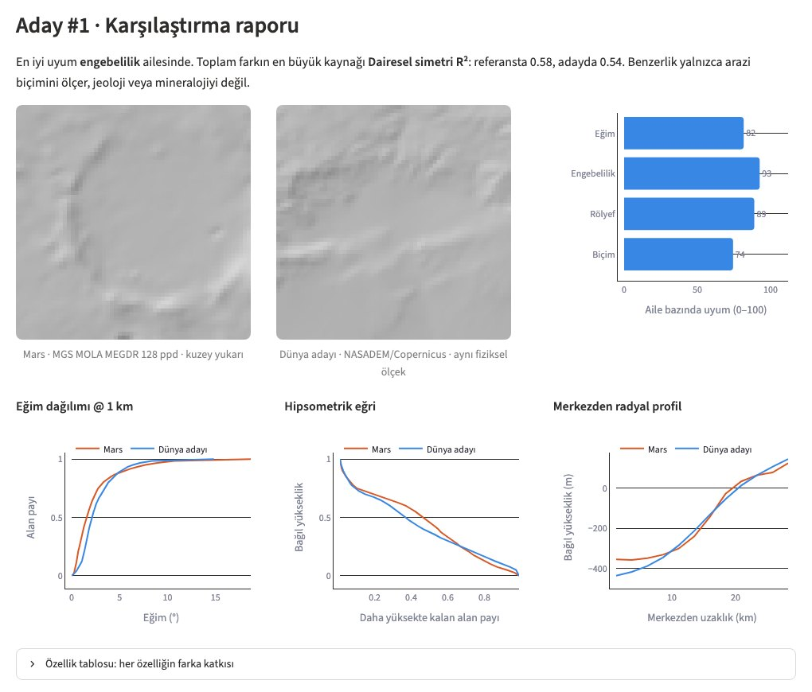

   *Şekil 14. 1 numaralı adayın raporu. En iyi uyum engebelilik ailesinde (93), en büyük fark dairesel simetride. Profil merkezi Jezero'da 4 km, adayda 6 km kaymış.*
5. **Sentinel-2:** Düğmeye basınca sahne, NDVI, NDMI ve SWIR göstergeleri gelir.
6. **Literatürdeki analoglar:** 15 alanın bu referansa uzaklığı.
7. **Bilimsel izlenebilirlik:** Yöntem, referans DEM, katalog tarihi ve parametreleri, başarısız karolar, veri kaynakları, yazılım sürümleri ve sınırlamalar.

### Sonuçları okurken

- Yüksek yüzdelik ve yüksek kararlılık birlikte sağlam bir eşleşme gösterir. Kararlılığı düşük bir aday ağırlık seçimine duyarlıdır.
- Özellik tablosu "neden" sorusunu yanıtlar. Toplam farkın büyük kısmı tek bir özellikten geliyorsa o özelliğe bakın.
- Benzerlik yalnızca arazi biçimini ölçer. Jeoloji, mineraloji ve oluşum süreci aynı olmayabilir.

### Örnek senaryo: rover için yürünebilir bir analog

Bir ekip, Jezero tabanına benzeyen ve araç testine uygun bir Dünya bölgesi arıyor olsun:

1. Gezegen olarak Mars'ı, alan olarak Jezero Krateri'ni seçin.
2. Araç için eğim önemli olduğundan **Eğim** ağırlığını artırın, örneğin 25'ten 60'a.
3. Çıplak zemin filtresini açık bırakın. Gerekirse "En az çıplak zemin" eşiğini 0,7'ye çıkarın.
4. Listede yüzdeliği ve kararlılığı yüksek adayları seçip raporunda eğim dağılımı grafiğine bakın: turuncu ve mavi eğriler yakınsa eğim yapısı benzer demektir.
5. Sentinel-2 düğmesiyle yüzeyin gerçekten çıplak olup olmadığını kontrol edin.
6. "Literatürdeki analoglar" tablosunda bilinen test alanlarının aynı ağırlıklarla nerede durduğuna bakın.

### Örnek senaryo: krater biçimli bir analog

Kenarı belirgin bir kraterin Dünya'daki biçim eşini arıyorsanız:

1. Özel koordinatla Tooting kraterini (23,17°K, −152,2°) seçin.
2. Yüzey filtresini kapatın; Dünya'daki kraterlerin çoğu göl ya da orman içindedir.
3. **Radyal profil** dışındaki ağırlıkları sıfıra çekin.
4. İlk aday Kanada'daki Mistastin çarpma krateri çıkar (Şekil 5). Varsayılan ağırlıklarda ise ilk sıralarda kraterler yoktur, çünkü aşınmış Dünya kraterleri eğim ve rölyef bakımından taze bir Mars kraterinden çok farklıdır.

## 9. Notebook, komut satırı ve Python

**Notebook.** [notebooks/01_jezero_salda.ipynb](../notebooks/01_jezero_salda.ipynb) bilimsel analizin tamamını içerir: veri okuma, aynı ölçekte görünüm, ham ve eşlenmiş eğim karşılaştırması, özellik tablosu, MOLA veri desteği, yanlılık ve kör arama deneyleri (pencere merkezinde ve kaymış sorguyla), küresel arama, bilinen analoglar, krater biçimi örneği (Tooting), açıklama, yüzey katmanı ve bulgular. `.venv` çekirdeğiyle açılır.

**Katalog üretimi:**

```bash
.venv/bin/python scripts/build_catalog.py --global --output data/catalog/earth_global.parquet
.venv/bin/python scripts/build_catalog.py --region 36 42 26 45 --output data/catalog/turkiye.parquet
```

Seçenekler: `--window-km` (varsayılan 60), `--stride-km` (20), `--workers` (8 süreç), `--threads` (12 bağlantı).

**Belgenin şekilleri:** `python scripts/make_doc_figures.py` bu belgedeki şekilleri gerçek veriden, açık ve koyu tema için yeniden üretir ve örneklerdeki sayıları yazdırır. Yöntem değiştiğinde belgeyi güncel tutmak için kullanın. Uygulama ekran görüntüleri (`docs/img/uygulama-*.jpg`) elle alınmıştır.

**Testler:** `pytest` ağ gerektirmeyen testleri, `pytest -m network` gerçek uzak verilerle çalışan testleri koşturur. `tests/test_terrain.py` analitik yanıtı bilinen yapay arazileri, `tests/test_similarity.py` doğru cevabı bilinen yapay bir kataloğu, `tests/test_data_layers.py` karo birleştirme, deniz karoları, WorldCover ve MOLA okumayı sınar.

**Python'dan kullanım.** Proje kökünden `PYTHONPATH=src` ile:

```python
from analog_finder.bodies import MARS
from analog_finder.catalog import CATALOG_DIR, load_catalog
from analog_finder.query import window_features
from analog_finder.similarity import Filters, explain, rank_candidates

catalog, meta = load_catalog(CATALOG_DIR / "earth_global.parquet")
reference, _ = window_features(MARS, 18.38, 77.58)  # Jezero
ranking = rank_candidates(reference.values, catalog, meta["feature_names"], filters=Filters.bare_ground())
print(ranking.table[["rank", "lat", "lon", "score", "percentile", "stability"]])
print(explain(ranking, reference.values, ranking.table.iloc[0]).head())
```

## 10. Kod yapısı

| Yer | Görevi |
|---|---|
| `src/analog_finder/bodies.py` | Gövdeler (yarıçap) ve Mars/Ay DEM ürünleri |
| `src/analog_finder/dem.py` | Uzak DEM okuma, Dünya karoları, birleştirme ve önbellek |
| `src/analog_finder/terrain.py` | Destek eşleme, metrik ızgara, özellikler ve radyal profil |
| `src/analog_finder/catalog.py` | Dünya kataloğunun üretimi ve okunması |
| `src/analog_finder/query.py` | Herhangi bir gövdede tek pencerenin özellikleri |
| `src/analog_finder/similarity.py` | Dönüşüm, ölçekleme, ağırlık, sıralama, kararlılık ve açıklama |
| `src/analog_finder/landcover.py` | WorldCover payları |
| `src/analog_finder/surface.py` | Sentinel-2 sahne arama ve göstergeler |
| `src/analog_finder/mola_support.py` | MOLA gerçek ölçüm yoğunluğu |
| `src/analog_finder/validation.py` | İz deseni, kör arama (pencere merkezinde ve kaymış) ve yanlılık deneyleri |
| `src/analog_finder/sites.py` | Referans alanları ve bilinen analoglar |
| `src/analog_finder/provenance.py` | Yöntem metni, veri kaynakları ve sürüm kayıtları |
| `app/streamlit_app.py` | Web arayüzü |
| `scripts/build_catalog.py` | Katalog üretim komutu |
| `notebooks/` | Bilimsel analiz |
| `tests/` | Testler |
| `data/catalog/` | Hazır katalog (git'te) |
| `data/cache/` | İndirilen veriler (git'te değil) |

Başlıca kütüphaneler: numpy ve scipy (filtreler, enterpolasyon), pandas ve pyarrow (katalog), rasterio (GDAL üzerinden GeoTIFF ve HTTP aralık okuma), requests (STAC ve PDS istekleri), Streamlit (arayüz), folium (haritalar), plotly (grafikler), matplotlib (notebook).

## 11. Geliştirme

- **Dal düzeni:** `main` dalı canlı uygulamadır. Streamlit Community Cloud her push'ta uygulamayı yeniden kurar. Yeni işler ayrı bir dalda yapılır ve hazır olunca `main`'e birleştirilir.
- **Bağımlılıklar:** Yeni bir paket hem `pyproject.toml` dosyasına hem de sürümü sabitlenmiş olarak `requirements.txt` dosyasına eklenir. Streamlit Cloud ikincisini kullanır.
- **Yeni bir özellik eklemek:**
  1. Hesabı `terrain.py` dosyasına yazın ve adını `PER_SCALE_FEATURES` ya da `WINDOW_FEATURES` listesine ekleyin. Pencereden daha geniş bir alana bakıyorsa `read_half_m` okuma alanını da büyütün.
  2. `similarity.py` dosyasında etiketini (`_LABELS`), ailesini (`family_of`) ve dönüşümünü (`transform`) tanımlayın.
  3. Yanıtı bilinen yapay bir araziyle test yazın.
  4. Kataloğu yeniden üretin.
  5. Katalog dosyasını commit edin. GitHub 50 MB üstündeki dosyalar için uyarı verir; dosya başına kesin sınır 100 MB'tır.
- **Yeni bir veri kaynağı eklemek:**
  - Mars veya Ay için `bodies.py` dosyasına yeni bir `DemProduct` eklenir. Ürün, HTTP aralık isteğiyle okunabilen global, basit silindirik bir GeoTIFF olmalıdır. Çözünürlüğün farklı olması sorun değildir, destek eşleme bunu karşılar. Yalnızca en küçük ölçeğin piksel boyunun 1,9 katından büyük olması gerekir.
  - Dünya için `dem.fetch_earth_tile` ve `default_earth_source` güncellenir.
  - Her iki durumda kaynak `provenance.py` dosyasına kaydedilir.
- **Platformlar:** macOS, Linux ve Windows. Komutlar README'de.

## 12. Sınırlamalar

- Benzerlik puanı olasılık değildir ve jeoloji veya mineraloji içermez.
- MOLA, 1 km'den küçük yapıları güvenilir biçimde temsil etmez. Jezero deltası gibi birkaç km'lik yapılar için HRSC gerekir.
- Pencereler 20 km adımla dizilir; bir yapının merkezi en yakın pencere merkezinden 14 km'ye kadar uzakta olabilir. Radyal profil merkezini aradığı için bundan etkilenmez, diğer özellikler etkilenir: sorgu 10 km kaydığında kör arama ilk sırada yalnızca %20 isabet ediyor.
- Pencere boyu tektir (60 km). Çok daha küçük veya büyük yapılar bu ölçeğe sığmaz; örneğin Manicouagan pencereden büyüktür.
- Radyal profil yükseltilmiş krater kenarını ayırt edebilir (Tooting → Mistastin), ama varsayılan ağırlıkta diğer aileler baskındır. Jezero gibi kenarı aşınmış kraterler için en yakın adaylar yine kapalı havzalardır.
- Mars ve Ay'da yerçekimi, atmosfer ve aşınma farklıdır. Benzer biçimler farklı süreçlerden doğmuş olabilir.
- 80°'den yüksek enlemlerde Mars ve Ay için kutup ürünleri henüz eklenmedi.
- Sentinel-2 özeti tek sahneye dayanır ve MGRS karo kenarlarında pencerenin bir kısmını kapsamayabilir.

## 13. Yol haritası

Tamamlanan: **krater biçimine duyarlı radyal profil** ([4.5](#45-radyal-profil)).

1. **Birden çok pencere boyutu**, örneğin 15, 30 ve 120 km. Kaymış sorgu deneyi, pencereye bağlı özelliklerin konum kaymasına duyarlı olduğunu gösterdi; daha sık pencere adımı ya da sorguda pencereyi kaydırarak arama da değerlendirilmeli.
2. **USGS Ay jeoloji haritası** ile jeolojik bağlam.
3. **Seçilmiş Mars bölgeleri için HRSC.** ESA'nın Mars Express HRSC ve MOLA birleşik modeli yaklaşık 200 m çözünürlüktedir. Ardından CRISM ve OMEGA ile mineraloji.

Değerlendirilen diğer kaynaklar: Ay için SLDEM2015 (LOLA ve Kaguya birleşimi, ±60° içinde yaklaşık 59 m), kutup ürünleri, Chang'e-2'nin 20 m'lik Ay DEM'i. Chang'e-2 verisi kayıt ve kullanım koşulları gerektirdiği için şimdilik dışarıda.

## 14. Terimler

| Terim | Anlamı |
|---|---|
| DEM | Sayısal yükseklik modeli: her hücrede bir yükseklik değeri bulunan ızgara |
| COG | Cloud Optimized GeoTIFF; parça parça okunabilen GeoTIFF |
| HTTP aralık isteği | Dosyanın yalnızca istenen bayt aralığını indirmek |
| STAC | Uydu sahnelerini aramak için ortak katalog standardı |
| Destek | Bir değerin temsil ettiği fiziksel alan; yumuşatmanın genişliği |
| Azimutal eşit uzaklık izdüşümü | Merkezden her yöne uzaklıkları doğru koruyan harita izdüşümü |
| TRI | Terrain Ruggedness Index, arazi engebelilik indeksi |
| IQR | Çeyrekler arası aralık: 75. ve 25. yüzdelikler arasındaki fark |
| Hipsometrik integral | Yüksekliğin, en düşük ile en yüksek arasında nerede yoğunlaştığı |
| NDVI, NDMI | Bitki örtüsü ve nem için normalize fark indeksleri |
| SCL | Sentinel-2 sahne sınıflandırması (bulut, gölge, su vb.) |
| MOLA, LOLA | Mars ve Ay'ın lazer altimetre ölçümleri |
| MEGDR | MOLA'nın ızgaralanmış yükseklik ürünü |
| ppd | Derece başına piksel |
| Yay saniyesi | Derecenin 1/3600'ü; Dünya'da ekvatorda yaklaşık 31 m |
| σ (profilde) | Diskteki yükseklik oynaklığı; profil halkaları bu birimle yazılır |
